# GoPilot benutzen

Anleitung zur App GoPilot: Teil A für Auszubildende, Teil B für Lehrkräfte.

GoPilot hilft dabei, das eigene Lernen in Moodle selbst zu steuern. Du planst deine Woche, arbeitest Lernschritte ab, schaust am Ende zurück und bekommst Rückmeldung von deiner Lehrkraft. Alle Lerninhalte kommen aus Moodle. GoPilot ist die Schicht darüber, die Planung, Reflexion und Coaching zusammenbringt.

Die Screenshots zeigen die Testumgebung mit den Kursen „LF5 Software zur Verwaltung von Daten anpassen“ und „LF8 Daten systemübergreifend bereitstellen“.

## Die wichtigsten Begriffe

| Begriff | Bedeutung |
|---|---|
| **Lernpfad** | eine Lernsituation, in Moodle ein Kursabschnitt |
| **Lernschritt** | eine Aktivität im Lernpfad, z. B. eine Seite oder eine Abgabe |
| **Soll-Termin** | bis wann ein Lernschritt erledigt sein sollte |
| **Wochenplan** | deine Auswahl an Lernschritten für eine Woche, dazu dein **Wochenziel** |
| **Reflexion** | dein Rückblick auf die Woche: allgemein und pro Kurs, mit **Selbsteinschätzung** |
| **Coaching-Feedback** | Rückmeldung deiner Lehrkraft zu deiner Kursreflexion; du kannst antworten |
| **Schulwoche / Betriebswoche** | Woche mit bzw. ohne Unterricht in einem Kurs |
| **Förder-Ampel** | Hinweis, ob in einem Kurs Unterstützung sinnvoll sein könnte, keine Bewertung |

---

# Teil A: Für Auszubildende

## Anmelden

Öffne GoPilot im Browser deines Handys oder Rechners. Melde dich mit **denselben Zugangsdaten wie in Moodle** an.

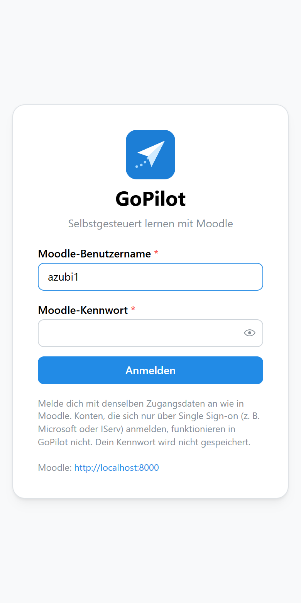

Dein Kennwort wird nicht gespeichert, GoPilot merkt sich nur einen Zugangsschlüssel. Konten, die sich in Moodle nur über Single Sign-on anmelden (z. B. über Microsoft oder IServ), funktionieren in GoPilot nicht. Dann brauchst du ein Moodle-Kennwort.

Unten auf dem Handy findest du die Navigation: **Start**, **Lernpfade**, **Plan**, **Reflexion** und **Mehr**.

## Start: deine Woche auf einen Blick

Die Startseite zeigt die laufende Kalenderwoche mit deinem Wochenziel und den geplanten Lernschritten.

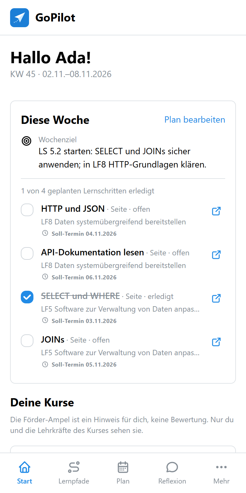

- **Abhaken:** Lernschritte, die du selbst als erledigt markieren darfst, hakst du direkt hier ab. Das landet auch in Moodle. Abgaben und Tests setzt Moodle automatisch auf erledigt, sobald die Bedingung erfüllt ist.
- **In Moodle öffnen:** Das Pfeil-Symbol rechts öffnet die Aktivität in Moodle in einem neuen Tab.
- Hast du noch nichts geplant, erscheint oben der Hinweis **Woche planen**. Ab Freitag erinnert dich GoPilot ans **Reflektieren**.

Weiter unten stehen **Deine Kurse** mit Kursfortschritt und Förder-Ampel:

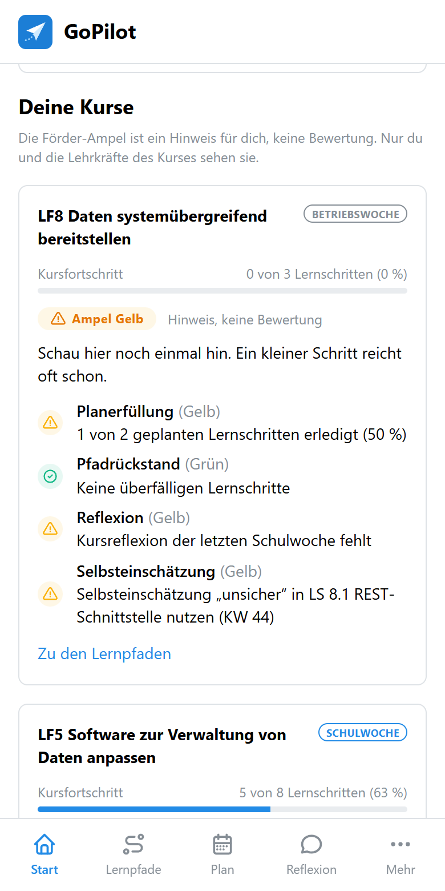

### Die Förder-Ampel verstehen

Die Ampel ist ein **Hinweis für dich, keine Note**. Nur du und die Lehrkräfte des Kurses sehen sie, Vergleiche mit anderen gibt es nicht. Sie setzt sich aus vier Signalen zusammen, und bei jedem steht, warum es so ist:

| Signal | Worum es geht | Standard-Grenzen |
|---|---|---|
| **Planerfüllung** | Wie viele deiner geplanten Lernschritte hast du in der letzten Schulwoche geschafft? | grün ab 70 %, gelb ab 40 %, darunter rot |
| **Pfadrückstand** | Wie viele Lernschritte sind über ihren Soll-Termin hinaus noch offen? | 0–1 grün, 2–3 gelb, ab 4 rot |
| **Reflexion** | Hast du die letzten Schulwochen reflektiert? | 1 fehlende Woche gelb, 2 in Folge rot |
| **Selbsteinschätzung** | Wie sicher hast du dich zuletzt eingeschätzt? | „unsicher“ gelb, „komme nicht klar“ rot |

Die Ampel zeigt immer das schlechteste Signal. Ein grauer Kreis bedeutet, dass ein Signal gerade nicht ausgewertet wird, z. B. in einer Betriebswoche. Deine Lehrkraft kann die Grenzen für ihren Kurs anpassen.

## Lernpfade

Unter **Lernpfade** wählst du einen Kurs und siehst seine Lernsituationen mit Fortschritt. Ein Lernpfad lässt sich aufklappen und zeigt dann seine Lernschritte:

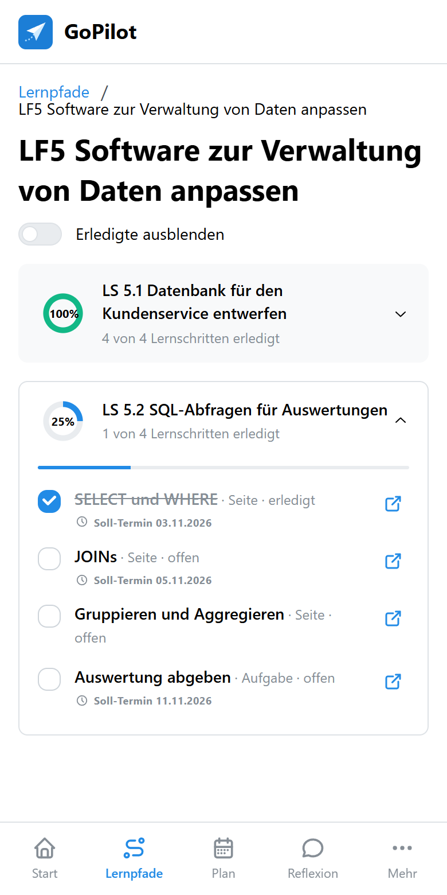

- Bei jedem Lernschritt steht der **Soll-Termin**. Ist er schon vorbei und der Schritt noch offen, ist er orange markiert („Soll-Termin war …“).
- Mit **Erledigte ausblenden** blendest du fertige Schritte aus.

## Woche planen

Unter **Plan** legst du fest, was du dir für **diese** oder die **nächste Woche** vornimmst.

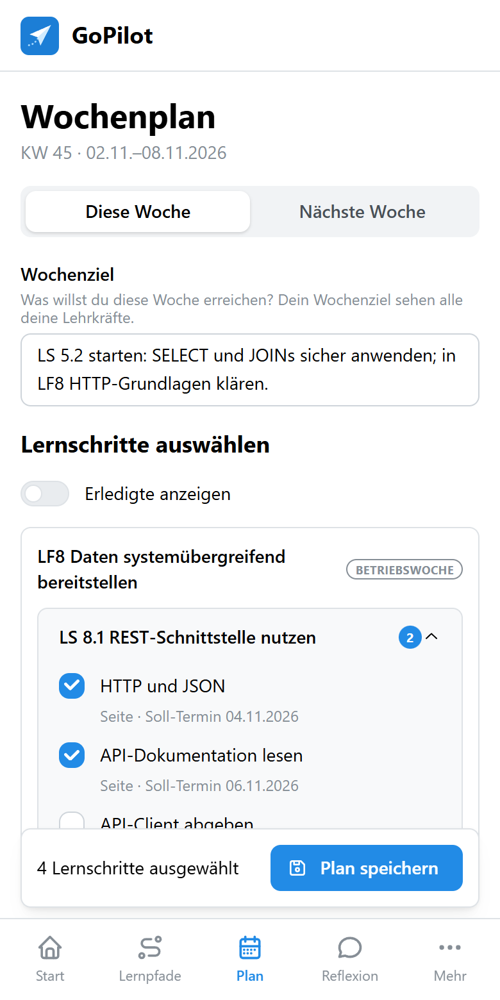

1. **Wochenziel formulieren:** Was willst du in dieser Woche erreichen? Dein Wochenziel sehen alle deine Lehrkräfte.
2. **Lernschritte auswählen:** Die Lernschritte sind nach Kurs und Lernpfad sortiert. Die Badges zeigen, ob in diesem Kurs **Schulwoche** oder **Betriebswoche** ist. Bereits erledigte Schritte sind ausgeblendet, über **Erledigte anzeigen** holst du sie zurück.
3. **Plan speichern:** Die Leiste unten zeigt, wie viele Schritte du ausgewählt hast.

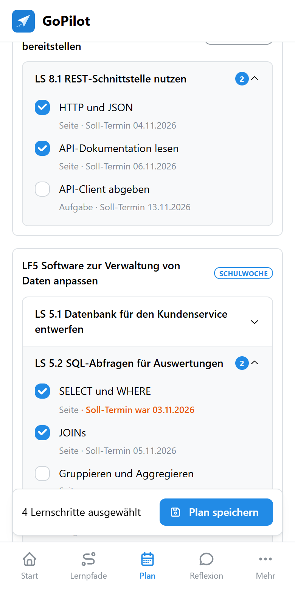

Tipps:

- Plane lieber weniger und schaffe es. Die Planerfüllung zählt nur in Schulwochen.
- In Betriebswochen ist Planen freiwillig. Es hilft aber, am Ball zu bleiben.
- Vergangene Wochen lassen sich nicht mehr umplanen.

## Woche reflektieren

Unter **Reflexion** schaust du auf **diese** oder die **letzte Woche** zurück. Ältere Wochen kannst du nur noch lesen.

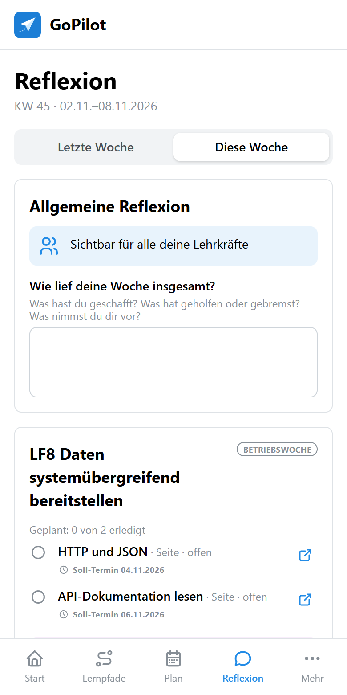

Die Reflexion hat zwei Teile, die **unterschiedlich sichtbar** sind:

- **Allgemeine Reflexion** (blauer Hinweis): Wie lief deine Woche insgesamt? Das sehen **alle deine Lehrkräfte**.
- **Kursreflexion** (lila Hinweis): Wie bist du in diesem Kurs vorangekommen? Das sehen **nur die Lehrkräfte dieses Kurses**.

Für jeden Lernpfad, aus dem du Schritte geplant hattest, gibst du eine **Selbsteinschätzung** ab: *sicher*, *geht so*, *unsicher* oder *komme nicht klar*, auf Wunsch mit Kommentar. Ehrlich sein lohnt sich: Gerade „unsicher“ und „komme nicht klar“ sind für deine Lehrkraft das Signal, auf dich zuzugehen.

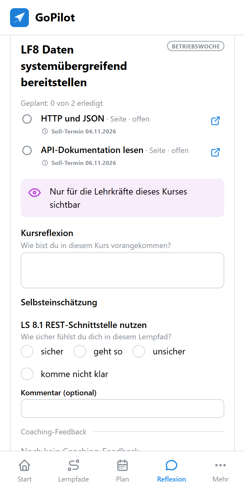

Am Ende speicherst du mit **Reflexion speichern**. Deine Lehrkräfte werden benachrichtigt.

### Coaching-Feedback

Unter jeder Kursreflexion steht der Gesprächsfaden mit deiner Lehrkraft. Antworten kannst du direkt darunter, auch in älteren Wochen.

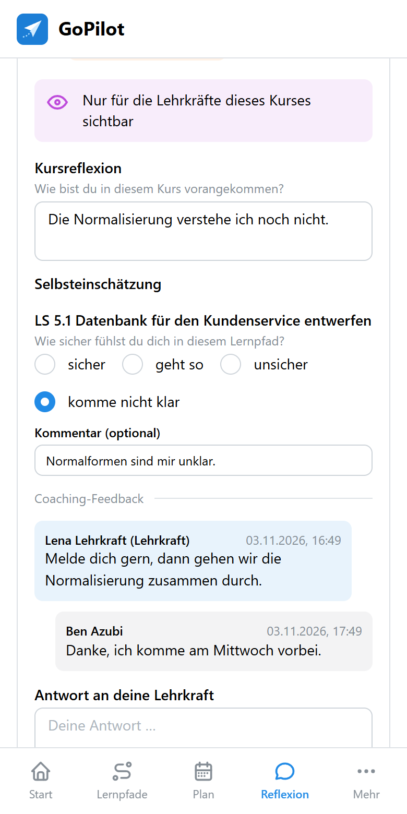

Kommt neues Feedback, bekommst du eine Benachrichtigung, als Push oder in Moodle.

## Lernbiografie

Unter **Mehr → Lernbiografie** siehst du alle deine Wochen untereinander: Ziel, Plan mit Ergebnis, Reflexionen und Feedback.

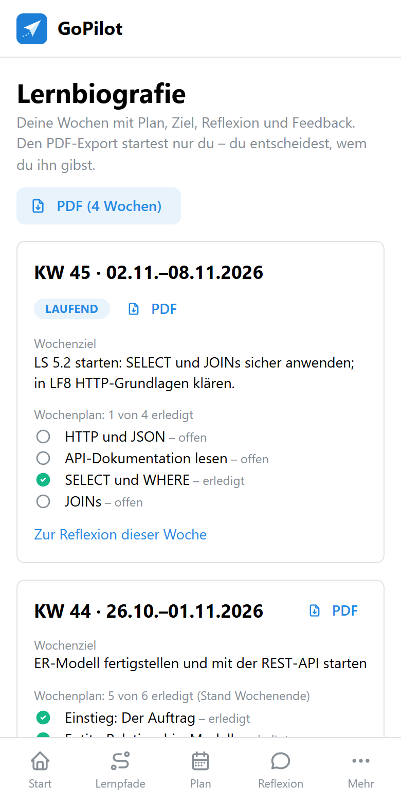

Mit **PDF** exportierst du alle geladenen Wochen oder eine einzelne Woche. Den Export kannst nur du auslösen. Ob du ihn weitergibst, etwa an deinen Ausbildungsbetrieb, entscheidest du selbst.

## Einstellungen

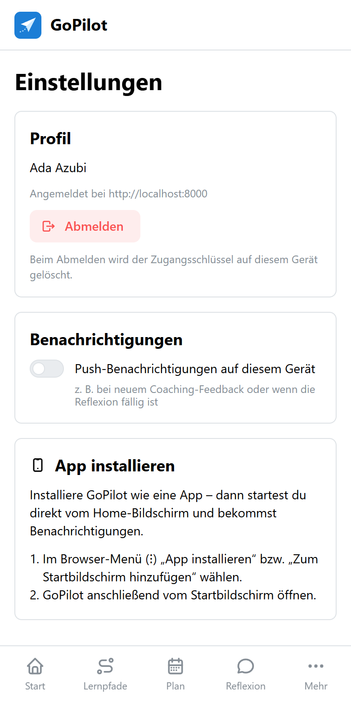

Unter **Mehr → Einstellungen** kannst du:

- dich **abmelden**: Der Zugangsschlüssel wird auf diesem Gerät gelöscht.
- **Push-Benachrichtigungen** für dieses Gerät ein- oder ausschalten.
- GoPilot **als App installieren**: Dann startest du direkt vom Home-Bildschirm. Auf dem iPhone kommen Push-Nachrichten nur an, wenn GoPilot installiert ist (in Safari: Teilen → „Zum Home-Bildschirm“).

---

# Teil B: Für Lehrkräfte

Als Lehrkraft eines Kurses sind Sie dort automatisch **Lerncoach**. Voraussetzung ist, dass der Moodle-Kurs wie in der Anleitung [Moodle-Kurs für GoPilot vorbereiten](lehrkraefte-moodle.md) aufgebaut ist. Am Rechner zeigt GoPilot links eine Seitenleiste mit **Lerndoku** und, wenn Sie den Kurs bearbeiten dürfen, **Kurseinstellungen**.

## Lerndoku

Die Lerndoku zeigt alle Lernenden eines Kurses mit Förder-Ampel, den vier Signalen, dem Kursfortschritt und der letzten Kursreflexion.

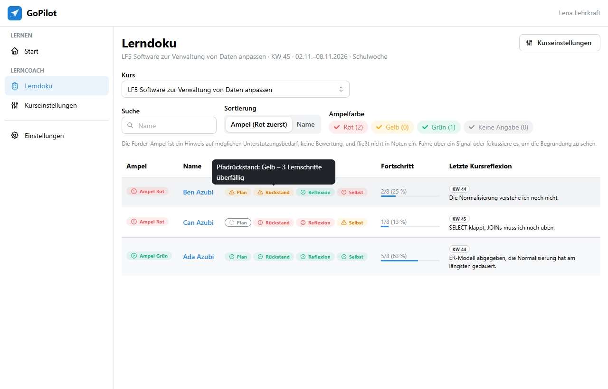

- **Sortierung:** Standardmäßig steht Rot oben, alternativ nach Name.
- **Filter:** Über die Ampelfarben blenden Sie z. B. nur Lernende mit Rot ein. Über **Suche** finden Sie einzelne Namen.
- **Signale:** Fahren Sie mit der Maus über ein Signal, um die Begründung zu sehen, z. B. „Pfadrückstand: Gelb – 3 Lernschritte überfällig“.
- Ein Klick auf den Namen öffnet die Detailansicht.

Die Ampel ist ein Gesprächsanlass, keine Bewertung, und fließt nicht in Noten ein. Lernende sehen nur ihre eigene Ampel.

## Detailansicht einer:eines Lernenden

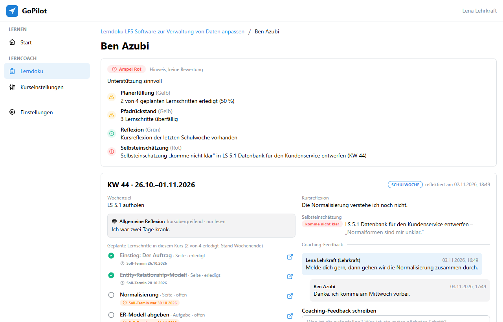

Oben stehen Ampel und Signale, darunter die Wochen, neueste zuerst. Pro Woche sehen Sie:

- **Wochenziel** und **allgemeine Reflexion**: kursübergreifend, nur zum Lesen. Alle Lehrkräfte der:des Lernenden sehen sie.
- die **geplanten Lernschritte dieses Kurses** mit Stand und Soll-Termin.
- **Kursreflexion** und **Selbsteinschätzung** pro Lernpfad.
- den **Coaching-Feedback-Faden**. Unter **Coaching-Feedback schreiben** antworten Sie, die:der Lernende wird benachrichtigt und kann zurückschreiben.

Neue Reflexionen in Ihren Kursen meldet GoPilot Ihnen standardmäßig im Moodle-Benachrichtigungsbereich.

## Kurseinstellungen

Die Kurseinstellungen kann ändern, wer den Kurs in Moodle bearbeiten darf (Rolle Trainer/in).

### Unterrichtswochen

Wählen Sie die Kalenderwochen, in denen Ihr Kurs Unterricht hat. Nur in diesen **Schulwochen** zählen Planerfüllung und fehlende Reflexion. In Betriebswochen bleiben diese Signale stumm.

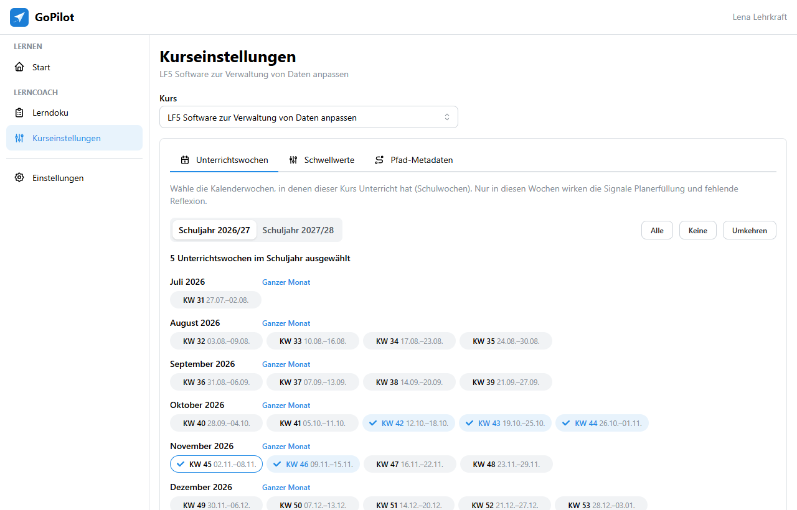

- Wochen sind nach Monaten gruppiert, mit Kalenderwoche und Datum. **Ganzer Monat**, **Alle**, **Keine** und **Umkehren** beschleunigen die Auswahl.
- Pflegen Sie die Wochen am besten einmal zum Schuljahresbeginn aus dem Blockplan.
- Ohne Unterrichtswochen wertet GoPilot nur Pfadrückstand und Selbsteinschätzung aus.

### Schwellwerte

Hier legen Sie fest, ab wann ein Signal gelb oder rot wird. Solange **Standardwerte verwenden** eingeschaltet ist, gelten die Werte aus Teil A. Die Stufen der Selbsteinschätzung sind fest.

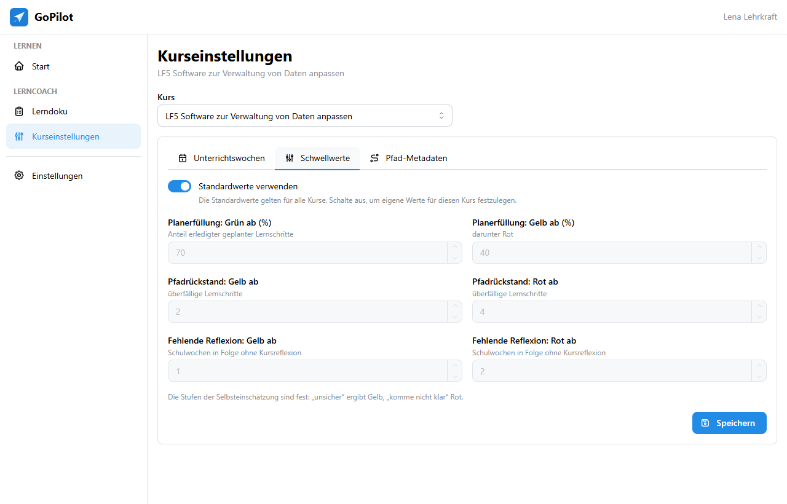

### Pfad-Metadaten

Für jeden Lernpfad und Lernschritt können Sie optional **Phase** (z. B. „Informieren“), **Dauer** in Minuten und **Niveau** angeben. Die Lernenden sehen die Angaben in den Lernpfaden und beim Planen.

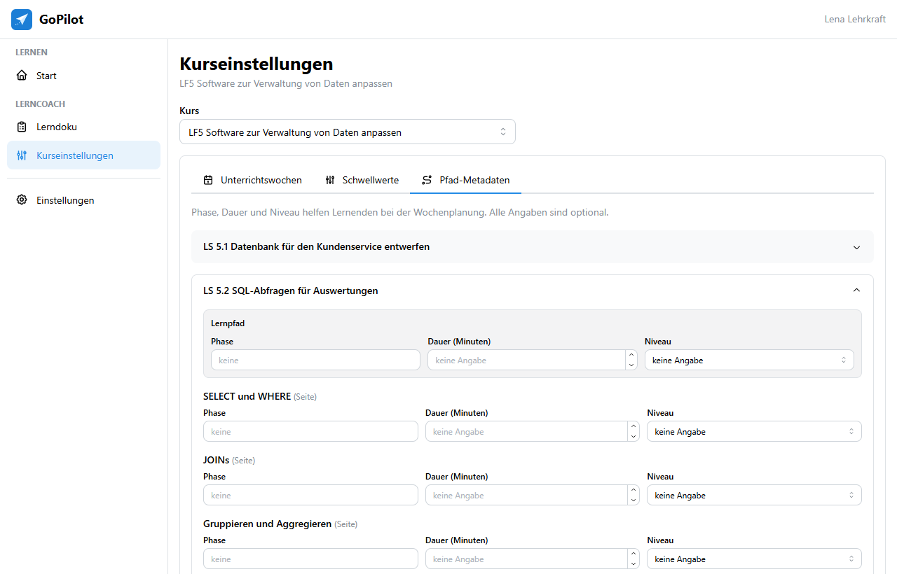

## Häufige Fragen

**Eine Ampel steht auf Rot, obwohl die:der Lernende gut mitarbeitet.**
Schauen Sie auf das auslösende Signal. Oft sind es Soll-Termine, die für die Lerngruppe zu früh liegen, oder Unterrichtswochen, die nicht stimmen. Passen Sie die Termine in Moodle oder die Kurseinstellungen an.

**Ein Signal zeigt einen grauen Kreis.**
Es wird gerade nicht ausgewertet, z. B. weil keine Unterrichtswochen hinterlegt sind, die letzte Woche keine Schulwoche war oder nichts aus diesem Kurs geplant wurde.

**Lernende sehen einen Lernschritt nicht.**
GoPilot zeigt nur Aktivitäten, die in Moodle sichtbar und für die Person verfügbar sind. Textfelder und der Abschnitt „Allgemeines“ erscheinen nicht.
