# Moodle-Kurs für GoPilot vorbereiten

Anleitung für Lehrkräfte (und am Ende für die Moodle-Administration).

GoPilot ist die App, mit der Auszubildende ihr Lernen selbst planen, verfolgen und reflektieren. Ihre Inhalte holt GoPilot direkt aus Moodle. Damit das funktioniert, muss der Moodle-Kurs nach ein paar einfachen Regeln aufgebaut sein. Alles in dieser Anleitung erledigen Sie in Moodle selbst, eine Zusatzsoftware brauchen Sie nicht.

> Die GoPilot-App ist noch in Entwicklung. Die hier beschriebene Vorbereitung in Moodle gilt aber schon jetzt: Ein Kurs, der so aufgebaut ist, funktioniert später ohne Nacharbeit in GoPilot.

Die Screenshots stammen aus der Testumgebung mit dem Beispielkurs „LF5 Software zur Verwaltung von Daten anpassen“ (Moodle 4.5).

## Wie GoPilot einen Moodle-Kurs liest

| In Moodle | In GoPilot | Wofür GoPilot es nutzt |
|---|---|---|
| Kursabschnitt | **Lernpfad** (eine Lernsituation) | Gliederung, Fortschrittsanzeige |
| Aktivität oder Material im Abschnitt, in Moodle-Reihenfolge | **Lernschritt** | Auswahl für den Wochenplan |
| Aktivitätsabschluss („Erledigt“) | Lernschritt erledigt | Planerfüllung, Fortschritt |
| „Erinnerung in der Zeitleiste setzen“ bzw. Fälligkeitsdatum einer Aufgabe | **Soll-Termin** | Pfadrückstand in der Förder-Ampel |
| Rolle Trainer/in im Kurs | **Lerncoach** | Lerndoku, Coaching-Feedback |
| Rolle Teilnehmer/in im Kurs | **Lernende:r** | Lernplaner, Reflexion |

Daraus ergeben sich vier Regeln:

1. **Eine Lernsituation = ein Abschnitt.** Lernsituationen nicht über mehrere Abschnitte verteilen und nicht mehrere in einen Abschnitt packen.
2. **Jeder Lernschritt braucht eine Abschlussbedingung.** Ohne sie kann GoPilot nicht erkennen, ob ein Schritt erledigt ist.
3. **Soll-Termine setzen, wo es einen Zeitplan gibt.** Ohne Termin gibt es für diesen Schritt kein Rückstand-Signal.
4. **Die Reihenfolge im Abschnitt ist die Reihenfolge im Lernpfad.**

## Schritt 1: Abschlussverfolgung im Kurs einschalten

Öffnen Sie den Kurs und wählen Sie **Einstellungen**. Klappen Sie den Bereich **Abschlussverfolgung** auf und stellen Sie ein:

- **Abschlussverfolgung aktivieren:** Ja
- **Abschlussbedingungen anzeigen:** Ja (empfohlen, damit die Lernenden in Moodle sehen, was zu tun ist)

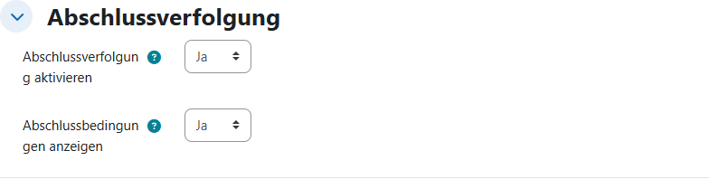

Speichern Sie mit **Speichern und anzeigen**.

## Schritt 2: Lernsituationen als Abschnitte anlegen

Schalten Sie oben rechts **Bearbeiten** ein. Jeder Abschnitt erhält dann ein Stift-Symbol neben dem Namen und unten die Schaltfläche **Aktivität oder Material anlegen**.

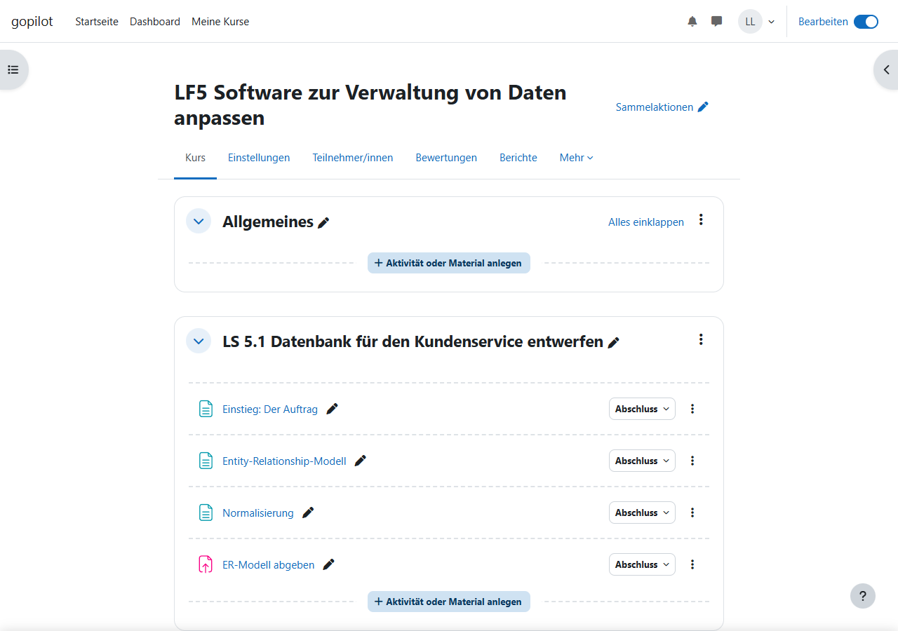

Legen Sie für jede Lernsituation einen Abschnitt an und geben Sie ihm einen sprechenden Namen. Klicken Sie dazu auf das Stift-Symbol oder im Drei-Punkte-Menü des Abschnitts auf **Bearbeiten**:

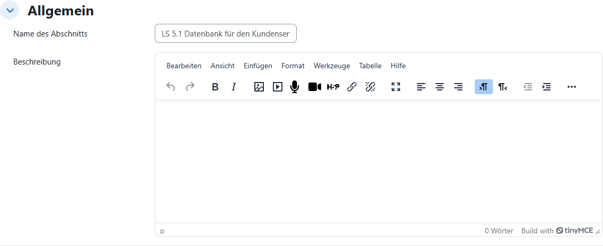

Tipps:

- Beginnen Sie den Namen mit der Nummer der Lernsituation, z. B. „LS 5.1 …“. So bleibt die Reihenfolge auch in GoPilot klar.
- In der **Beschreibung** können Sie die Handlungssituation kurz zusammenfassen.
- Der Abschnitt **Allgemeines** ganz oben ist kein Lernpfad. Legen Sie dort nur Kursweites ab (Ankündigungen, Material für alle Lernsituationen).

## Schritt 3: Lernschritte als Aktivitäten anlegen

Legen Sie innerhalb eines Abschnitts die Lernschritte in der Reihenfolge an, in der sie bearbeitet werden sollen. Jede Aktivität und jedes Material kann ein Lernschritt sein, z. B. Textseite, Aufgabe, Test, H5P, Datei oder Link.

So sieht der fertige Beispielkurs aus. LS 5.1 hat vier Lernschritte, der vierte ist eine Abgabe:

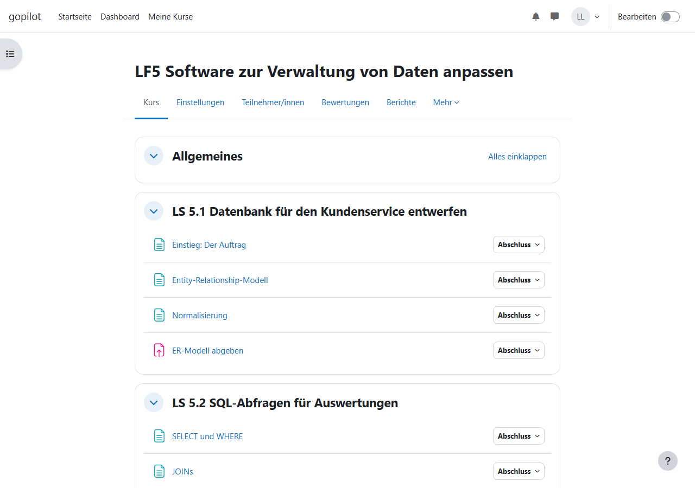

Die Reihenfolge ändern Sie im Bearbeitungsmodus per Drag-and-drop oder über **Verschieben** im Drei-Punkte-Menü der Aktivität.

## Schritt 4: Abschlussbedingung und Soll-Termin festlegen

Öffnen Sie bei jedem Lernschritt die Einstellungen (Stift-Symbol oder **Einstellungen bearbeiten**) und klappen Sie **Abschlussbedingungen** auf:

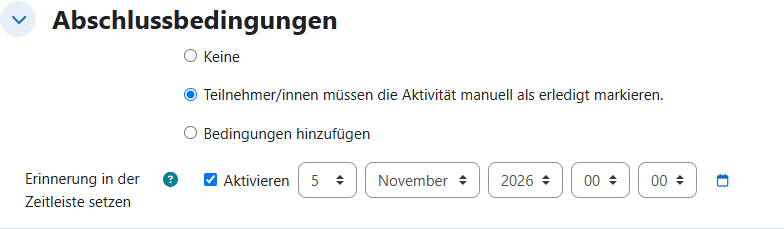

**Abschlussbedingung:** Wählen Sie entweder

- **Teilnehmer/innen müssen die Aktivität manuell als erledigt markieren:** passt zu Material und Übungen. Die Lernenden haken den Schritt selbst ab, in Moodle und später auch in GoPilot.
- **Bedingungen hinzufügen:** z. B. „Lösung abgeben“ bei Aufgaben oder „Bestehensbewertung erreichen“ bei Tests. Moodle setzt den Abschluss dann automatisch.

**Keine** führt dazu, dass GoPilot den Schritt nie als erledigt erkennt.

**Soll-Termin:** Aktivieren Sie **Erinnerung in der Zeitleiste setzen** und tragen Sie das Datum ein, bis zu dem der Schritt erledigt sein soll. Bei Aufgaben zählt auch das **Fälligkeitsdatum** im Bereich **Verfügbarkeit**.

> GoPilot zählt einen Lernschritt als Rückstand, wenn sein Soll-Termin verstrichen und der Schritt nicht erledigt ist. Sind mehrere Schritte im Rückstand, springt die Förder-Ampel auf Gelb oder Rot. Setzen Sie Termine deshalb realistisch, also nicht auf den ersten Tag einer Lernsituation.

Schritte ohne festen Termin, etwa vertiefende Zusatzaufgaben, lassen Sie ohne Erinnerung. Sie zählen dann nie als Rückstand.

## Schritt 5: Rollen prüfen

Unter **Teilnehmer/innen** sehen Sie, wer im Kurs welche Rolle hat:

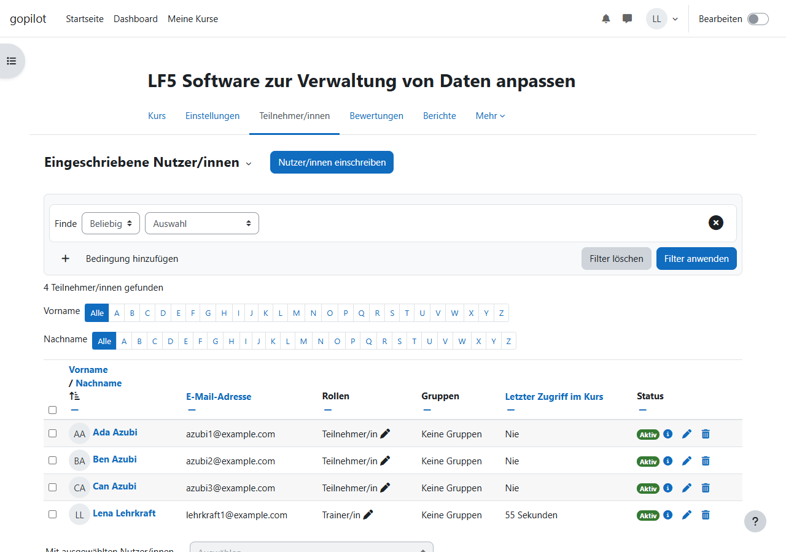

| Rolle in Moodle | Was sie in GoPilot darf |
|---|---|
| **Teilnehmer/in** | GoPilot als Lernende:r nutzen: Wochen planen, reflektieren, eigene Ampel sehen |
| **Trainer/in ohne Bearbeitungsrecht** | Lerncoach: Lerndoku und Ampeln aller Lernenden des Kurses sehen, Coaching-Feedback geben |
| **Trainer/in** | wie oben, zusätzlich Kurseinstellungen in GoPilot ändern (z. B. Unterrichtswochen, Ampel-Schwellwerte) |

Jede Lehrkraft mit einer Trainer-Rolle ist automatisch Lerncoach für genau diesen Kurs. Eine eigene Zuweisung ist nicht nötig.

## Kontrolle: So sehen es die Lernenden

Melden Sie sich zur Probe mit einem Test-Account als Teilnehmer/in an oder nutzen Sie **Rolle wechseln** im Nutzermenü. Bei jedem Lernschritt erscheint dann **Als erledigt kennzeichnen** bzw. **Erledigt**:

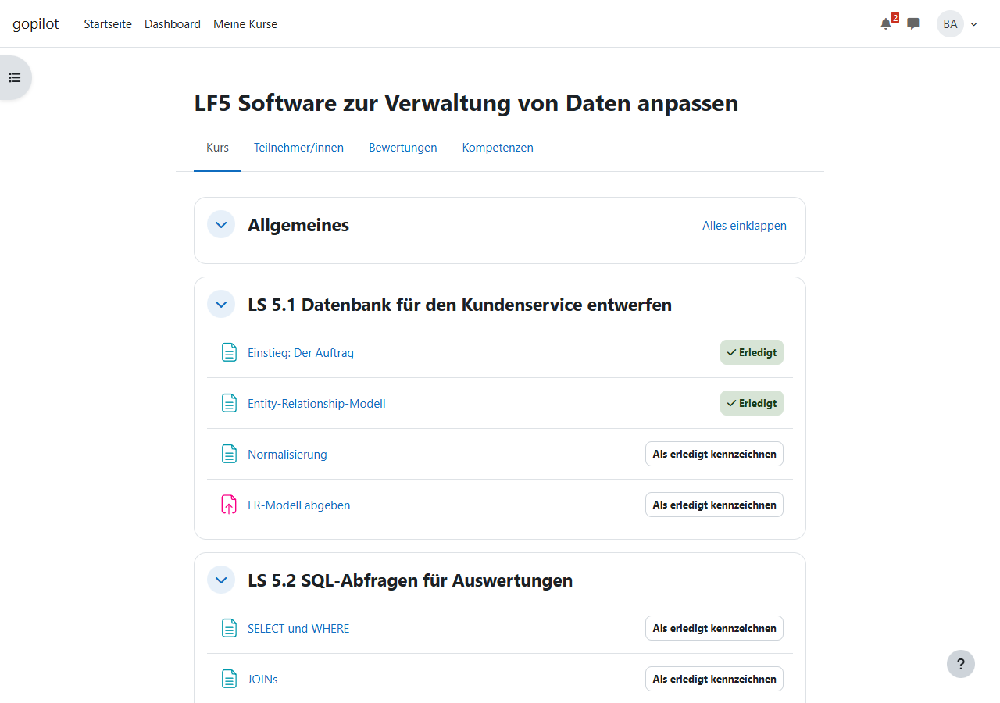

Fehlt bei einem Schritt diese Schaltfläche (und auch ein Hinweis auf eine automatische Bedingung), hat er keine Abschlussbedingung. Holen Sie dann Schritt 4 nach.

## Kontrolle: Lernstand im Abschlussbericht

Unter **Berichte → Aktivitätsabschluss** sehen Sie für alle Lernenden, welche Schritte erledigt sind. Orange Datumsangaben im Spaltenkopf markieren Soll-Termine, die schon verstrichen sind.

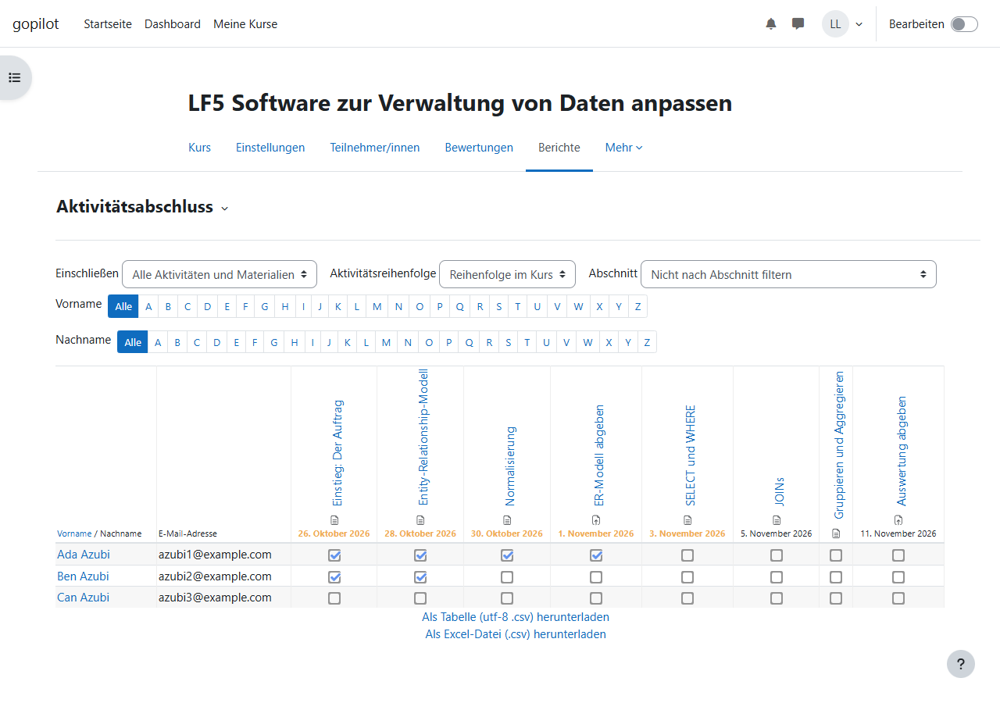

Dieselben Daten wertet GoPilot für die Lerndoku aus. Im Beispiel liegen zum Stichtag fünf Soll-Termine in der Vergangenheit:

| Lernende:r | Erledigt | Im Rückstand | Signal „Pfadrückstand“ (Standard-Schwellwerte) |
|---|---|---|---|
| Ada | 4 | 1 | grün (0–1) |
| Ben | 2 | 3 | gelb (2–3) |
| Can | 0 | 5 | rot (ab 4) |

## Checkliste

- [ ] Abschlussverfolgung im Kurs eingeschaltet
- [ ] Jede Lernsituation ist genau ein Abschnitt mit sprechendem Namen
- [ ] Lernschritte stehen in der gewünschten Reihenfolge
- [ ] Jeder Lernschritt hat eine Abschlussbedingung (nicht „Keine“)
- [ ] Soll-Termine gesetzt, wo es einen Zeitplan gibt
- [ ] Lehrkräfte haben eine Trainer-Rolle, Auszubildende die Rolle Teilnehmer/in
- [ ] Probeansicht als Teilnehmer/in zeigt bei jedem Schritt „Als erledigt kennzeichnen“ oder eine Bedingung

## Was später in GoPilot dazukommt

Folgende Einstellungen nehmen Sie nicht in Moodle vor, sondern später in GoPilot:

- **Unterrichtswochen:** In welchen Kalenderwochen der Kurs Unterricht hat (Blockunterricht). Nur in diesen Wochen fließen Planerfüllung und fehlende Reflexion in die Ampel ein.
- **Ampel-Schwellwerte:** Ab wie vielen Rückständen oder welcher Planerfüllung ein Signal gelb oder rot wird. Ohne Anpassung gelten Standardwerte.
- **Pfad-Metadaten:** Phase, geschätzte Dauer und Niveau eines Lernschritts.

---

## Für die Moodle-Administration

Die folgenden Einstellungen gelten für die ganze Moodle-Instanz. Sie werden einmalig von der Administration vorgenommen.

### Plugin installieren

Das Moodle-Plugin `local_gopilot` wird wie jedes lokale Plugin nach `local/gopilot` installiert, anschließend wird das Upgrade unter **Website-Administration → Mitteilungen** ausgeführt. Dabei werden der Webservice-Dienst **GoPilot** und die Rechte `local/gopilot:use`, `:coach` und `:configure` angelegt.

### Webservices aktivieren

**Website-Administration → Allgemein → Zusatzoptionen → Webservices aktivieren** einschalten:

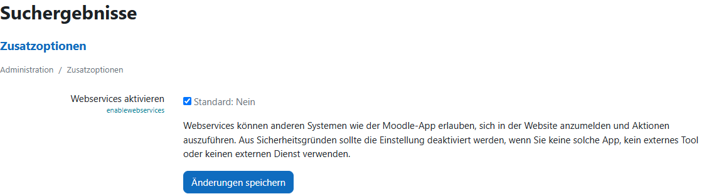

### Protokoll REST aktivieren

**Website-Administration → Server → Webservices → Protokolle verwalten:** **Protokoll REST** aktivieren (Augen-Symbol offen). Weitere Protokolle braucht GoPilot nicht.

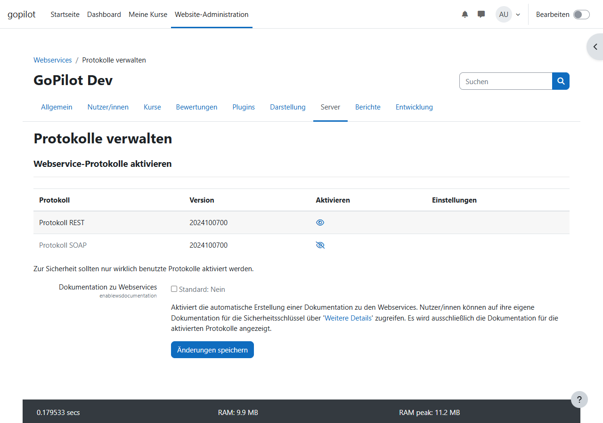

### Dienst GoPilot prüfen

Unter **Website-Administration → Server → Webservices → Externe Services** muss der Dienst **GoPilot** (Plugin `local_gopilot`) erscheinen und für **Alle Nutzer/innen** freigegeben sein:

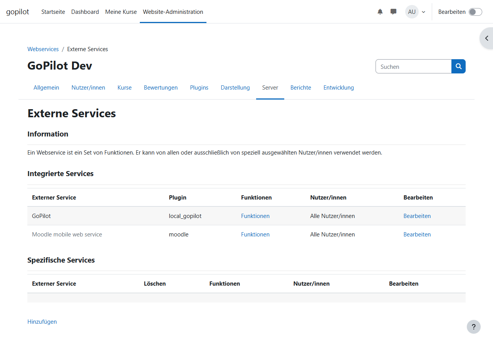

### Token-Erzeugung erlauben

Damit sich Lernende und Lehrkräfte mit ihrem Moodle-Benutzernamen und Kennwort in GoPilot anmelden können, braucht die Rolle **Authentifizierte/r Nutzer/in** unter **Website-Administration → Nutzer/innen → Rechte ändern → Rollen verwalten** diese beiden Rechte:

- `moodle/webservice:createtoken`
- `webservice/rest:use`

Die Anmeldung läuft über `login/token.php`. SSO-Anmeldungen (z. B. über einen Identitätsanbieter) werden in Version 1 nicht unterstützt. Betroffene Konten brauchen ein Moodle-Kennwort.

### Zugriff von der App-Domain (CORS)

GoPilot läuft auf einer eigenen Domain und ruft Moodle direkt aus dem Browser auf. Moodle erlaubt das an `login/token.php` und `webservice/rest/server.php` von sich aus. **Am Webserver ist keine CORS-Konfiguration nötig.** Setzen Sie für diese beiden Adressen auch keine eigenen `Access-Control-Allow-Origin`-Header: Doppelte Header führen dazu, dass der Browser die Antworten verwirft (siehe [ADR 0007](../adr/0007-app-auf-eigener-domain.md)).
